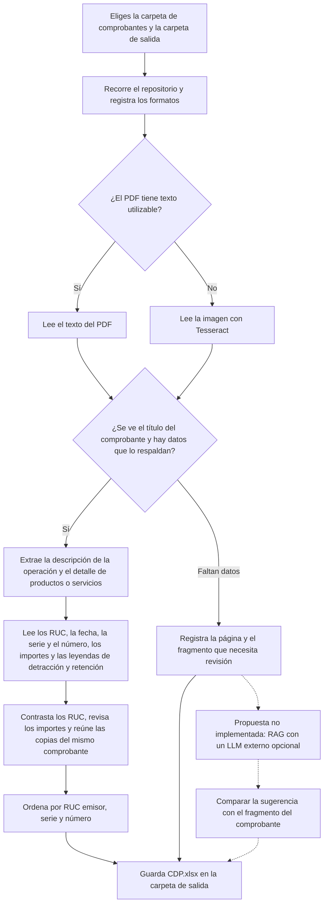
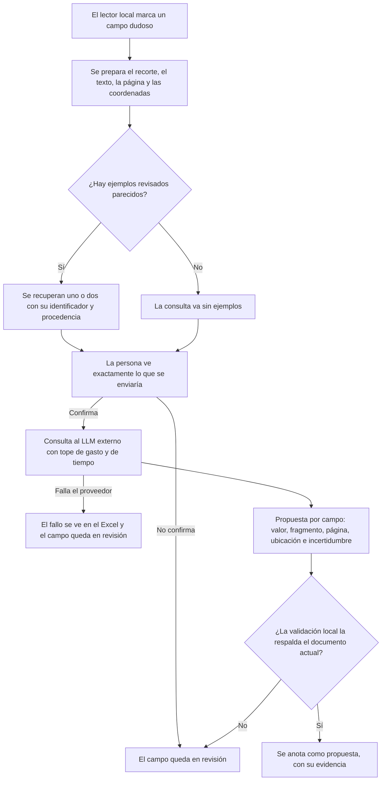

# OCR CDP

Convierte un archivo digital de comprobantes de pago en una tabla de Excel. Lee el contenido de PDF digitales, PDF escaneados e imágenes como JPG, PNG, TIFF, BMP y WebP, también dentro de ZIP. Guarda el resultado en `CDP.xlsx` y señala qué página revisar cuando falta un dato. Los documentos se leen en tu equipo.

## Empezar

Necesitas Python 3.11, 3.12 o 3.13. Abre una terminal en la carpeta del proyecto y ejecuta:

```text
python iniciar.py
```

El mismo script prepara una carpeta local llamada `.venv`, instala las librerías que falten y abre una ventana. La primera vez necesita internet para descargar esas librerías. Después puedes volver a abrirlo con el mismo comando.

Para leer fotos y páginas escaneadas, instala [Tesseract](https://tesseract-ocr.github.io/tessdoc/Installation.html), que es el programa que convierte una imagen en texto. Activa español e inglés si vas a dejar los idiomas de fábrica. Si Tesseract falta, los PDF que ya contienen texto se siguen leyendo. Las páginas que necesitan el programa quedan señaladas en el Excel.

En la ventana, pulsa **Examinar** junto a **Carpeta de entrada** para elegir tus comprobantes. Pulsa **Examinar** junto a **Carpeta de salida** para elegir dónde guardar `CDP.xlsx`. Escribe el RUC del comprador que quieres comparar y pulsa **Iniciar análisis**. Al terminar, puedes abrir el libro desde la misma ventana.

## Abrir el proyecto en VS Code desde cero

1. Instala [Visual Studio Code](https://code.visualstudio.com/), Python 3.11, 3.12 o 3.13 y, si vas a leer escaneos, Tesseract con los idiomas español e inglés.
2. En VS Code, **Archivo → Abrir carpeta…** y elige la carpeta del proyecto, la que contiene `iniciar.py`.
3. VS Code propondrá instalar las extensiones recomendadas del proyecto: **Python** y **Markdown Preview Mermaid Support**. Acepta las dos. Sin la segunda, la vista previa de Markdown muestra los diagramas como texto.
4. Abre una terminal (**Terminal → Nuevo terminal**) y ejecuta `python iniciar.py`. La primera vez crea la carpeta `.venv`, instala las librerías con versiones fijas y abre la ventana del programa.
5. Si VS Code pregunta con qué intérprete trabajar, elige el de `.venv` (`Ctrl+Shift+P` → *Python: Select Interpreter*).
6. Para ver los diagramas, abre este `README.md` y pulsa `Ctrl+Shift+V`, o el icono de vista previa de la esquina superior derecha del editor.
7. Con `F5` (**Ejecutar y depurar**) puedes abrir la ventana del programa con el depurador, o lanzar **Analizar una carpeta**, que te pregunta la carpeta de entrada, la de salida y el RUC.

En GitHub los diagramas se dibujan solos, sin extensiones.

## Mapa de lo que hace



El libro contiene cinco pestañas, con nombres de columnas y estados en español y palabras separadas por guiones bajos.

| Pestaña | Qué contiene y para qué sirve |
| --- | --- |
| `cdp_detectados` | Una fila por representación principal de cada comprobante identificado. Muestra emisor, receptor, descripción, fechas, importes y ubicación del original. |
| `notas` | Notas de crédito y débito y la referencia al comprobante afectado cuando se puede leer. |
| `revision` | Datos incompletos, lecturas dudosas, importes que requieren cotejo y documentos cuyo tipo no pudo identificarse. Incluye la ubicación y el fragmento disponible. |
| `inventario` | Archivos y miembros de ZIP encontrados, su estado y las exclusiones, como XML y HES. Permite comprobar qué se procesó y qué quedó fuera. |
| `resumen` | Totales y estado de la corrida. Aparece al final del libro. |

La descripción se toma de la glosa impresa o de las filas reconocibles del detalle. Las fechas se guardan como fechas de Excel y se muestran como **DD/MM/AAAA**. El programa puede recorrer carpetas con formatos mezclados. Para extraer el contenido de un formato nuevo hace falta añadir y probar su lector.

Cuando la fecha de emisión no se lee, la celda queda vacía: el programa no la deduce del nombre del archivo ni de otro comprobante. Esa ausencia aparece además como un hallazgo en `revision`, con la página donde buscarla en el original.

`denominacion_observada` muestra el título del documento tal como se lee en la página, por ejemplo `FACTURA ELECTRÓNICA`. En muchos comprobantes el título comparte renglón con el teléfono, el RUC o el nombre del emisor porque están en columnas distintas; en ese caso la columna `evidencia_de_la_denominacion` conserva el renglón completo del que salió, para que puedas cotejarlo. Si el renglón ya contenía sólo el título, esa columna queda vacía. Ningún carácter se completa ni se corrige: si el título viene mal leído, se muestra mal leído.

`estado_oficial` dice `pendiente` en todos los comprobantes detectados. Este programa **no** consulta la validez de emisión en SUNAT: detectar un documento y verificar oficialmente que fue emitido son dos cosas distintas, y aquí sólo se hace la primera. El `resumen` lo repite en «Canal oficial de validación» y en «CDP confirmados oficialmente».

La columna `razon_social_observada` queda vacía cuando la lectura no identifica con suficiente claridad el nombre del emisor en el comprobante. El RUC por sí solo no rellena ese campo, y el programa no deduce el nombre por su posición en la página. Cuando queda vacía, lo anota como hallazgo en `revision`. Si configuras un padrón compatible, el nombre registrado aparece en la columna `razon_social_del_padron`, aparte, para que lo compares con el original: es una comparación, no un relleno.

El programa reconoce el nombre del emisor por la forma societaria que lo cierra, con puntos (`S.A.`, `S.A.C.`, `S.A.A.`, `S.R.L.`, `E.I.R.L.`) o sin ellos (`SAC`, `SAA`, `SRL`, `EIRL`). Quedan fuera tres situaciones, todas propias de páginas escaneadas:

- **El escáner leyó mal la forma societaria**, por ejemplo `S.A,` con coma, `EARL` en lugar de `EIRL` o `SAL` en lugar de `SAC`. El programa no da por buena una abreviatura que no reconoce, porque corregirla sería suponer qué decía el papel.
- **El emisor es una persona natural** (su RUC empieza por 10). Entonces no hay forma societaria: lo que figura es un nombre propio, a veces junto a un nombre comercial. El programa no elige entre los dos.
- **Sólo aparece el nombre comercial** y el nombre registrado no está impreso en la página.

En los tres casos la celda queda vacía a propósito y el hallazgo te dice en qué página mirar.

Por ejemplo, si lee una base de S/ 100 y un IGV de S/ 18, compara S/ 118 con el total impreso. Si aparecen importes inafectos, exonerados, no gravados o descuentos, los muestra por separado. Una cifra que falta queda en blanco. Las leyendas de detracción y retención se muestran tal como se encontraron en el comprobante.

## Propuesta: RAG con un LLM externo (no implementado)

> **Estado.** Esto es una guía de diseño. El programa **no** incluye RAG, no se conecta a ningún modelo, no hace llamadas de red y no necesita claves. Se explica aquí qué sería y cómo se construiría, para quien quiera implementarlo, discutirlo o descartarlo con criterio.

### Qué es un RAG

RAG significa *retrieval-augmented generation*: generación apoyada en una búsqueda previa. Antes de preguntarle algo a un modelo de lenguaje, el programa busca en una colección propia los fragmentos más parecidos a lo que se pregunta y se los entrega como contexto. El modelo no aprende nada por ello: sólo lee lo que se le pasa en esa consulta.

Dos cosas que conviene tener claras desde el principio:

- Un ejemplo recuperado enseña **cómo suele estar distribuida** una página. No es prueba de nada sobre el comprobante que tienes delante.
- Si al modelo sólo se le entrega texto, no puede recuperar lo que el OCR ya perdió. Si el escáner leyó `$755.00` donde el papel decía `S/ 55.00`, el modelo recibe `$755.00`. Para eso haría falta enviar el recorte de la imagen, con las consecuencias de privacidad que se explican más abajo.

### Dónde ayudaría y dónde no

| Caso | ¿Reglas locales o RAG? |
| --- | --- |
| Dígito verificador del RUC, formato de fechas y números, cuadre de importes | **Reglas locales.** Son comprobaciones exactas; un modelo sólo añadiría error. |
| Ruido del OCR entre una etiqueta y su valor, símbolo de moneda mal leído, corte de página | **Reglas locales.** Son defectos de lectura, no de interpretación. |
| Quién es el emisor y quién el receptor cuando el diseño de la página es inusual | Candidato a RAG: depende de la disposición. |
| Descripciones partidas en varias líneas o pegadas a cifras | Candidato a RAG, con el recorte de imagen. |
| Etiquetas con nombres poco habituales (fecha, moneda, leyendas de detracción) | Candidato a RAG. |
| Elegir entre nombre comercial y razón social registrada | Mejor el padrón local (`razon_social_del_padron`): contrasta con una fuente en lugar de opinar. |

La regla práctica: si existe una comprobación exacta, se usa. El modelo se reserva para lo que depende de la disposición de la página y que hoy el lector deja en `revision`.

### Cómo se construiría, paso a paso



**1. Reunir el corpus de ejemplos.** Cada ejemplo es un par: una región de un comprobante (texto o recorte) y el valor correcto, **revisado por una persona contra el original**. Cada uno lleva un identificador, su procedencia y la fecha de revisión. Reglas que no se negocian:

- Sólo entran ejemplos revisados a mano. Indexar las salidas sin revisar del propio programa contaminaría el corpus con sus errores.
- El corpus **no vive en el repositorio público**. Contiene datos reales de terceros. Cada quien mantiene el suyo.

**2. Partirlo en trozos pequeños.** Un ejemplo es una región con sentido (la cabecera con el título y el RUC, el bloque de importes, la zona de leyendas), no una página entera. Se guardan metadatos: tipo de campo, si el original era digital o escaneado, calidad. Con trozos pequeños, un ejemplo recuperado aporta estructura y no arrastra valores ajenos.

**3. Elegir cómo buscar.** Hay dos caminos, y conviene empezar por el más simple:

- *Búsqueda por palabras y por metadatos* (por ejemplo, SQLite con FTS5, que el proyecto ya usa para guardar su estado). Con cientos de ejemplos suele bastar y es fácil de auditar: se ve por qué salió cada resultado.
- *Búsqueda por vectores* (embeddings), con un modelo de embeddings propio o de un servicio, y un índice como `sqlite-vec` o FAISS. Se añade sólo si la medición demuestra que mejora lo anterior.

**4. Recuperar poco.** Uno a tres ejemplos como máximo y con un umbral de parecido: si ninguno lo supera, la consulta va sin ejemplos. Más contexto no es mejor contexto.

**5. Construir la consulta.** Instrucciones fijas, el campo que se pide, el fragmento actual y, aparte, los ejemplos, delimitados de forma explícita como *ejemplos de estructura, no datos del documento*. Se pide la respuesta en un formato estructurado.

**6. Pedir una respuesta estructurada.** Una propuesta por campo, con su respaldo. El esquema, con marcadores en lugar de datos:

```json
{
  "campo": "<nombre del campo pedido>",
  "propuesta": "<texto tal como se lee en el documento>",
  "pagina": 1,
  "fragmento_de_respaldo": "<renglón del documento actual>",
  "ubicacion": [0, 0, 0, 0],
  "incertidumbre": "baja | media | alta",
  "ejemplos_usados": ["<identificador del ejemplo>"]
}
```

**7. Validar en local, siempre.** Cada propuesta se comprueba contra el documento actual: sintaxis y dígito verificador del RUC, rol de emisor o receptor, que la fecha sea posible y esté escrita en la página, que la etiqueta exista, y la aritmética con decimales. Validar el formato o la suma no sustituye a la evidencia visual. Si hay conflicto o falta respaldo, el campo queda pendiente de revisión. Un valor que aparezca en un ejemplo recuperado pero **no** en el fragmento actual se rechaza: es la huella de una contaminación.

**8. Dejar rastro.** Cada consulta guarda qué ejemplos se usaron, qué proveedor y modelo respondió, la versión de las instrucciones, el coste y el resultado de la validación. Sin ese registro no se puede auditar después.

### Cómo se configuraría

El proveedor y el modelo no irían escritos en el código: serían ajustes, con la función **apagada de fábrica**. Un esquema posible para `config.json`, que hoy **no existe**:

| Ajuste propuesto | Para qué serviría |
| --- | --- |
| `llm_activado` | Interruptor general. Valor inicial `false`. |
| `llm_proveedor` y `llm_modelo` | Elegir a quién se consulta y con qué modelo. Detrás habría una interfaz común para poder cambiar de proveedor sin tocar el resto. |
| `llm_tope_gasto` | Límite de coste por lote. Al alcanzarlo, la función se detiene. |
| `llm_segundos_maximos` | Tiempo máximo de espera por consulta. |

La clave del servicio se leería de una variable de entorno. Nunca iría en `config.json` ni en el repositorio.

Un modelo que se ejecute en tu propio equipo es una alternativa válida cuando los documentos no pueden salir de él: se renuncia al coste por consulta y a la salida de datos, a cambio de hardware y, normalmente, de algo menos de calidad. La interfaz común permitiría usar uno u otro.

### Privacidad: qué implica enviar un comprobante

Un comprobante contiene datos de tus proveedores y de tus clientes. Enviarlo a un servicio externo significa sacarlo de tu equipo. Si se implementara, tendría que cumplir:

- Estar apagado hasta que alguien lo encienda a propósito.
- Mostrar en pantalla, antes de la primera consulta, **exactamente** lo que se enviaría: el texto o el recorte, con su archivo y su página. Sin confirmación no sale nada.
- Enviar sólo lo necesario para el campo dudoso, nunca el comprobante entero ni la carpeta.
- Tratar lo que devuelva el modelo como dato, jamás como instrucción: un texto incrustado en un comprobante o en un ejemplo no puede cambiar lo que hace el programa.
- Hacer visible cualquier fallo del proveedor en el Excel. Nunca convertirlo en una confirmación silenciosa.
- No decidir la validez oficial de ningún comprobante. Eso queda fuera del alcance de este programa, con o sin RAG.

### Cómo se mediría antes de usarlo

Un RAG sólo se justifica si mejora algo medible. Para comprobarlo hace falta:

- **Una referencia revisada contra los originales**, con la procedencia de cada valor. El programa ya incluye el mecanismo para compararla con la lectura (`plantilla-calibracion` y `calibrar`, más abajo).
- **Dos conjuntos separados**: el de los ejemplos que alimentan el corpus y el de evaluación. Evaluar con documentos cuyos ejemplos están en el corpus daría una cifra inflada.
- **La misma muestra y los mismos criterios** con y sin RAG. Se mide por campo: cuántos acierta, cuántos erra, cuántos deja vacíos, cuántos valores falsos introduce y cuántas propuestas rechaza la validación local.
- **El coste**: consultas por cada mil comprobantes multiplicadas por el precio vigente del proveedor elegido, que cambia y hay que consultar en su momento.

Una bajada del número de alertas no cuenta como mejora por sí sola: lo que importa es que lo recuperado sea correcto y que no aparezcan valores falsos.

## Ajustar la lectura

Abre [config.json](config.json) con un editor de texto. Cambia solo el valor a la derecha de cada nombre. Por ejemplo, para que el programa no abra el contenido de los ZIP, cambia `true` por `false` en `revisar_archivos_zip`. Guarda el archivo y vuelve a abrir el programa. Un archivo mal escrito muestra la línea que debes revisar.

| Ajuste | Valor inicial | Qué pasa si lo cambias |
| --- | --- | --- |
| `ruta_tesseract` | `"auto"` | Busca Tesseract en el equipo. Si está en otra carpeta, escribe la ruta entre comillas. En Windows puedes escribirla con barras normales, por ejemplo `"C:/Program Files/Tesseract-OCR/tesseract.exe"`. |
| `idiomas_ocr` | `"spa+eng"` | Lee texto de imágenes en español e inglés. Usa `"spa"` si solo instalaste español. Cada idioma que indiques debe estar disponible en Tesseract. |
| `segundos_por_pagina` | `90` | Es el tiempo máximo que Tesseract puede dedicar a una página. Admite enteros desde 1. Un valor mayor da más tiempo a páginas difíciles. Si se agota, la página queda en **Revisión**. |
| `umbral_confianza_ocr` | `70` | Va de 0 a 100. Si un dato clave leído en una imagen obtiene una puntuación menor, aparece en **Revisión**. Al subirlo, verás más alertas. La cifra leída y el tipo de documento se conservan. |
| `resolucion_pdf` | `220` | Es el nivel de detalle con que se prepara una página PDF para leerla como imagen. Admite enteros de 72 a 600. Un valor mayor puede ayudar con letras pequeñas y también consume más tiempo y memoria. Los PDF con texto utilizable se leen directamente. |
| `maximo_pixeles` | `40000000` | Es el tamaño máximo de imagen que se admite para leerla. Admite enteros desde 1. Si una imagen supera el límite, queda en **Revisión**. Aumentarlo permite imágenes más grandes y puede requerir más memoria. |
| `releer_recuadro_importes` | `false` | Usa `true` para probar una lectura adicional del cuadro de importes en facturas escaneadas de una sola página. Se aplica cuando el cuadro tiene límites claros y el cuadre quedó pendiente. Excel indica **Recuadro de importes** si las cifras leídas cuadran y el total coincide con el de la página. |
| `revisar_archivos_zip` | `true` | Usa `false` para omitir el contenido de los ZIP. La ventana permite cambiar esta opción para la corrida actual. |
| `padron_ruc` | `null` | Puedes escribir la ruta de una base local compatible para comparar la razón social asociada al RUC leído. Usa `null` para procesar sin padrón. El padrón se usa solo para el nombre. |

Las rutas relativas de estos ajustes se toman desde la carpeta del JSON. Los números se escriben sin comillas y `true`, `false` y `null` se escriben en minúsculas.

La resolución inicial de 220 DPI se eligió al comparar nueve documentos originales. Con los demás ajustes iguales, 220 DPI logró 90 coincidencias de 99 campos revisados y 300 DPI logró 84. Es una referencia para esa muestra. El umbral 70 determina cuándo se marca una lectura para revisión. En esa misma muestra, 70 y 80 produjeron dos alertas, mientras que 90 produjo siete. El umbral cambia las alertas y no mejora por sí mismo la lectura.

Son nueve documentos y 99 campos: una muestra pequeña, elegida porque estaba revisada contra los originales. Esos números valen para esa muestra y no son una tasa de acierto del programa. Repitiendo hoy esa comparación con los mismos nueve documentos y la misma referencia, `releer_recuadro_importes` pasa de 91 a 93 campos de 99. Dos campos de diferencia en nueve documentos no bastan para recomendarlo para todo. Por eso viene apagado: enciéndelo si tus facturas escaneadas tienen el cuadro de importes bien delimitado, y compruébalo con tus propios documentos.

De los seis campos que siguen sin coincidir en esa muestra, cuatro son del mismo comprobante escaneado, uno es un RUC con un dígito mal leído y el último es una palabra partida por el escáner (`aprobad o`). Ninguno se corrige a mano: quedan señalados en `revision`.

## Usar el mismo script desde la terminal

Reemplaza `RUC_RECEPTOR` por el número que quieres contrastar. Usa una carpeta de salida vacía y fuera de la carpeta de entrada.

```text
python iniciar.py scan --input entrada --output salida --recipient-ruc RUC_RECEPTOR
python iniciar.py export --output salida
```

El segundo comando vuelve a crear el Excel usando el estado local de esa corrida. Para usar otro archivo de ajustes, agrega `--config ajustes.json` a `scan` o `ui`. Consulta los comandos disponibles con `python iniciar.py --help`.

### Comparar ajustes con una muestra

Crea la plantilla Excel y anota en ella lo que ves en los originales. En **Archivo**, pon el nombre relativo a la carpeta de muestra. Las páginas y los bloques empiezan en 1. Deja en blanco los campos que no quieras comparar. En **Detección**, usa `cdp_detectado`, `no_cdp`, `indeterminado` o `error_de_lectura`.

```text
python iniciar.py plantilla-calibracion --output referencia.xlsx
python iniciar.py calibrar --input muestra --reference referencia.xlsx --output calibracion.xlsx --recipient-ruc RUC_RECEPTOR
```

Si quieres comparar dos ajustes, copia `config.json` a `ajustes-alternativos.json` y cambia un solo valor. Agrega `--config config.json --config ajustes-alternativos.json` al segundo comando. El Excel te muestra qué lecturas coincidieron, qué cambió y cuánto tardó cada opción. Guarda los comprobantes y los Excel de trabajo fuera del repositorio público.

## Leer el código

Los archivos de `src/ocr_fiscal` están comentados en español, paso a paso, como si se leyeran de arriba abajo: cada función dice qué hace y, dentro de ella, los pasos van numerados. El orden natural para entenderlo es este:

1. `iniciar.py` y `cli.py`: por dónde entra el programa.
2. `config.py`: los ajustes de `config.json`.
3. `archives.py` y `documents.py`: recorrer carpetas y ZIP, y leer cada página (texto nativo del PDF u OCR).
4. `extraction.py`: decidir qué es cada cosa en la página (tipo, RUC, serie, fecha, importes, detalle).
5. `processor.py`: orquesta todo y reúne las copias del mismo comprobante.
6. `exports.py`: arma `CDP.xlsx`.

Las partes marcadas con `DEPRECADO` en un comentario no las usa ningún otro código del programa. Se conservan por si alguna vez se retoma ese camino (por ejemplo, el lector de facturas XML), y se pueden borrar sin que cambie el resultado.

## Contribuir y licencia

Este proyecto es de código abierto bajo la **GNU Affero General Public License v3.0** (ver [LICENSE](LICENSE)). La licencia AGPL exige que, si ofreces una versión modificada como servicio a través de una red, también pongas su código a disposición de quienes lo usan. Las librerías PyMuPDF (AGPL-3.0) y Tesseract (Apache-2.0) tienen sus propias licencias.

Si quieres contribuir con un informe de error o con cambios:

- **No adjuntes comprobantes reales.** Contienen datos de terceros. Describe el caso con el texto mínimo que lo reproduce y sustituye los nombres, los RUC y los importes.
- Indica la versión de Python, la de Tesseract y el contenido de tu `config.json`.
- Un cambio en las reglas de lectura debe explicar qué defecto corrige y qué no cambia. Si un valor no se puede leer con evidencia, la respuesta correcta es dejarlo en blanco y señalarlo para revisión, no suponerlo.
