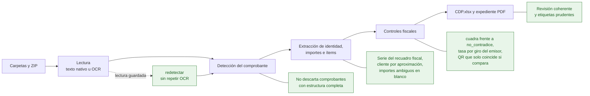
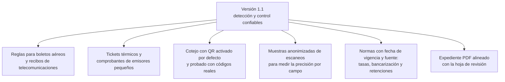
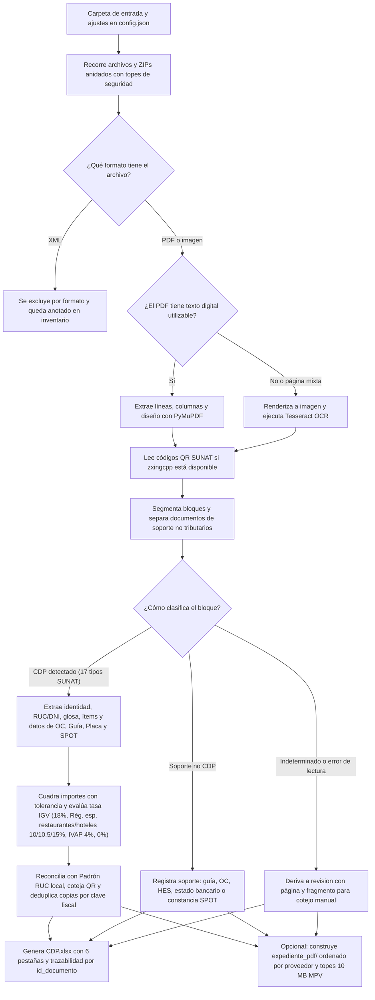

# OCR CDP

Herramienta local en Python pensada para contabilidad y auditoría tributaria en Perú. Recorre carpetas y archivos ZIP con representaciones visuales de comprobantes de pago **sin XML** (PDF digitales, híbridos, escaneados e imágenes `JPG`, `JPEG`, `PNG`, `TIF`/`TIFF`, `BMP` y `WebP`), extrae sus campos clave sin inventar datos dudosos y genera:

1. Un libro `CDP.xlsx` con seis pestañas orientadas al registro, revisión y *vouching* contable.
2. Opcionalmente, una carpeta `expediente_pdf/` ordenada por proveedor con anexos vinculados y alertas de peso para Mesa de Partes Virtual (MPV) de SUNAT.

Todo se procesa íntegramente en tu equipo, sin subir documentos a internet ni depender de servicios externos.

---

## Novedades: versión 1.1 · Detección y control más confiables

Esta versión cambia el criterio de fondo del programa: **lo que no se pudo comprobar ya no pasa por verificado**. Cada control dice con honestidad si comparó o no, y lo dudoso llega a `revision` con un motivo claro. A la vez, el programa lee mejor los comprobantes reales, así que deja menos trabajo manual.

**Detección más segura**
- Un comprobante con RUC, serie y correlativo e importes ya no se descarta como guía, orden de compra o estado de cuenta solo porque su título no se lee o porque menciona esos documentos.
- Las leyendas legales («R.S. … /SUNAT»), los teléfonos y las cuentas bancarias del pie ya no se confunden con la serie y el correlativo; se prefiere la serie del recuadro fiscal.
- El cliente se reconoce aunque el rótulo venga con variantes de escritura o errores del OCR, y aunque rótulos y valores estén en columnas separadas.
- Se leen la serie física «001 - N° 0012345» y las facturas electrónicas en inglés.
- Una línea de orden de compra dentro de la factura ya no la parte en dos.

**Importes que no se inventan**
- Un importe ambiguo, como `10.000`, queda en blanco y va a revisión en vez de leerse dividido entre mil.
- El `S/` mal leído por el OCR («57» o «Si») ya no se pega al importe.
- La confianza baja del OCR en base, IGV y total también genera aviso, no solo en los datos de identidad.
- Las descripciones y los ítems se leen mejor: la glosa se conserva y la cantidad y el precio no se mezclan con el texto.

**Controles que dicen lo que de verdad comprobaron**
- El cuadre distingue `cuadra` de `no_contradice`: sin IGV o sin componentes no se da por bueno, y no se fuerza con valores absolutos.
- El control de tasa usa una tolerancia fija, reconoce el IVAP solo cuando corresponde y marca las tasas especiales para verificar.
- Con la consulta RUC de SUNAT, la tasa especial de restaurantes y hoteles se decide por el giro del emisor y, en los giros mixtos, por lo que dice el propio comprobante.
- El cotejo con QR solo dice `coincide` si comparó RUC, serie y total, y avisa cuando no se pudo ejecutar.
- El aviso de retención en honorarios considera la moneda y ya no se apaga por una palabra suelta.
- El cotejo de razón social con el padrón distingue empresas de nombre parecido.

**Hojas coherentes y etiquetas prudentes**
- `requiere_revision_humana` coincide siempre con la hoja `revision`.
- Las ventas propias se reconocen como tales y no se cuentan dos veces.
- El ticket de máquina registradora ya no recibe un «No» de crédito fiscal: queda para verificar según el RUC del adquirente y el impuesto discriminado.
- «RUC OK» se sustituye por «RUC receptor coincide» y solo aparece si no hay otras observaciones.

**Trabajo más ágil y privado**
- El comando `redetectar` vuelve a aplicar las reglas sobre la lectura guardada, sin repetir el OCR.
- Los archivos de un ZIP ya no se retienen en memoria durante toda la corrida.
- El README advierte qué guarda la carpeta `.ocr_fiscal/` y cómo no conservarla.
- Se retiró código sin uso.



### Cómo puede seguir mejorando



---

## Empezar

Necesitas **Python 3.11, 3.12 o 3.13**. Abre una terminal en la carpeta del proyecto y ejecuta:

```text
python iniciar.py
```

Al ejecutarse, `iniciar.py` crea una carpeta local `.venv`, instala las dependencias fijas de `requirements.txt` (solo requiere internet la primera vez) y abre la ventana principal del programa. En adelante puedes volver a iniciarlo con el mismo comando.

Para leer fotos y PDF escaneados, instala [Tesseract OCR](https://tesseract-ocr.github.io/tessdoc/Installation.html) activando los idiomas español e inglés (`spa+eng`). Si Tesseract no está instalado, el sistema sigue leyendo normalmente los PDF que ya traen capa de texto digital y deriva a `revision` las páginas que requieren OCR.

En la ventana gráfica puedes elegir:
- **Carpeta de entrada** con tus comprobantes o ZIPs.
- **Carpeta de salida** (vacía y fuera de la de entrada) donde se guardará `CDP.xlsx`.
- **Padrón RUC (SQLite, opcional)** para contrastar razones sociales en local.
- **RUC objetivo (receptor)** del contribuyente que estás auditando.
- Si deseas inspeccionar contenedores **ZIP** y si deseas generar la carpeta ordenada **`expediente_pdf/`**.

## Abrir el proyecto en VS Code desde cero

1. Instala [Visual Studio Code](https://code.visualstudio.com/), Python 3.11, 3.12 o 3.13 y Tesseract (`spa+eng`) si vas a procesar escaneos.
2. En VS Code ve a **Archivo → Abrir carpeta…** y selecciona la carpeta raíz del proyecto (la que contiene `iniciar.py`).
3. VS Code sugerirá las extensiones recomendadas en [extensions.json](.vscode/extensions.json): **Python** (`ms-python.python`) y **Markdown Preview Mermaid Support** (`bierner.markdown-mermaid`). Conviene aceptar ambas para ver el diagrama de este `README.md` (`Ctrl+Shift+V`).
4. Abre una terminal integrada y ejecuta `python iniciar.py` para inicializar `.venv`. Luego selecciona el intérprete de `.venv` en VS Code (`Ctrl+Shift+P` → *Python: Select Interpreter*).
5. Con `F5` puedes ejecutar las configuraciones predefinidas en [launch.json](.vscode/launch.json): abrir la ventana gráfica o lanzar un análisis directo por carpeta.

En GitHub los diagramas Mermaid se dibujan automáticamente sin instalar extensiones.

---

## Herramientas y librerías que utiliza

| Componente | Para qué se usa en el proyecto | Dónde está definido |
| --- | --- | --- |
| `PyMuPDF` (`1.28.2`) | Lectura de texto nativo, detección de columnas y glifos dañados, renderizado de páginas para OCR, recorte/unión de PDFs en `expediente_pdf/`. | [requirements.txt](requirements.txt) |
| `Pillow` (`12.3.0`) | Carga de imágenes y TIFF multipágina, corrección de orientación EXIF y recompresión adaptativa de imágenes hacia PDF. | [requirements.txt](requirements.txt) |
| `openpyxl` (`3.1.5`) y `et-xmlfile` (`2.0.0`) | Construcción de `CDP.xlsx` (6 pestañas, formatos de texto, moneda y fechas reales) y plantillas de calibración. | [requirements.txt](requirements.txt) |
| `Tesseract OCR` *(programa externo)* | Reconocimiento óptico de caracteres por subproceso con salida TSV palabra por palabra y detección automática de rotación (`--psm 0`). | Configurado en [config.json](config.json) |
| Módulos estándar de Python | `sqlite3` (estado de corrida en `.ocr_fiscal/state.sqlite3` y Padrón RUC local), `zipfile` (apertura segura de ZIPs anidados; cada miembro por leer se escribe a un temporal del sistema que se borra al terminar la corrida), `tkinter` (ventana gráfica) y `unittest` (pruebas). | Biblioteca estándar de Python |
| Extras opcionales del entorno | Si instalas por separado `zxingcpp` en tu Python (`pip install zxing-cpp`), decodifica códigos QR SUNAT (incluso vectoriales); si instalas `pillow-heif`, admite imágenes `.heic`. Sin `zxingcpp` el cotejo QR no se ejecuta: la columna `cotejo_qr_sunat` dice `qr_no_ejecutado` (no `sin_qr`) y la hoja `resumen` lo avisa. | Opcionales (no incluidos en [requirements.txt](requirements.txt)) |

---

## Mapa de lo que hace



---

## Qué entrega en `CDP.xlsx`

El libro generado contiene **seis pestañas**, con encabezados en minúsculas separados por guiones bajos y una columna común `id_documento` para cruzar cualquier fila entre hojas:

| Pestaña | Qué contiene y para qué sirve |
| --- | --- |
| `cdp_detectados` | Una fila por representación principal de cada comprobante detectado (salvo notas `07` y `08`). Incluye RUC y razón social observada, tipo/serie/correlativo, emisión, vencimiento, condición de pago, cuotas, documento del adquirente (`RUC` o `DNI`), bases e importes, cuadre aritmético, tasa efectiva y control de IGV, `apto_credito_fiscal_preliminar`, `alerta_bancarizacion`, referencias citadas (`orden_de_compra_citada`, `guia_de_remision_citada`, `placa_vehicular`), datos SPOT (`%`, código y cuenta BN), cotejo con Padrón RUC al corte, peso del PDF en MB, alerta `>10 MB MPV` y anexos vinculados del mismo PDF. |
| `notas` | Notas de crédito (`07`) y débito (`08`) con el código y motivo SUNAT leído, uno o varios comprobantes afectados citados, si dichos comprobantes aparecen dentro del lote del mismo emisor, e importes con signo negativo en notas de crédito. |
| `revision` | Todo hallazgo que exige verificación visual humana con ubicación exacta y fragmento: lecturas con baja confianza OCR, identidades incompletas o en conflicto, diferencias aritméticas o de suma de ítems, RUC adquirente distinto del objetivo, posible venta propia mezclada, RUC ausente en padrón local, diferencias contra QR SUNAT, tasas IGV atípicas, RHE mayores a S/ 1,500 sin retención ni mención de suspensión (Form. 1609) y PDFs que superan 10 MB. |
| `inventario` | Inventario completo de archivos físicos y miembros de ZIP revisados, formatos excluidos (como XML), incidencias de contenedores (cifrados, corruptos o límites) y bloques descartados como soportes no CDP (`no_cdp`) indicando si quedaron archivados o vinculados a un comprobante. |
| `detalle_items` | Desglose fila por fila de productos o servicios leídos dentro de la tabla del comprobante (`id_documento`, clave fiscal, cantidad numérica preservando `0.0`, unidad, descripción, valor unitario, descuento e importe de línea), útil para clasificar cuentas del Plan Contable o centros de costo. |
| `resumen` | Totales de la corrida, contadores de revisión/tercero/`>10 MB`, canal de verificación y advertencias explícitas de alcance legal y tributario. Aparece siempre al final del libro. |

---

## Cobertura tributaria, tasas de IGV y cuadre de importes

### Comprobantes SUNAT reconocidos (17 códigos)
- `01` Factura
- `02` Recibo por honorarios
- `03` Boleta de venta *(incluye captura de `DNI` de 8 dígitos del cliente cuando no hay RUC)*
- `04` Liquidación de compra
- `05` Boleto de transporte aéreo *(incluye «Comprobante de compra» aéreo con contexto IATA/ticket)*
- `07` Nota de crédito
- `08` Nota de débito
- `10` Recibo por arrendamiento (Formulario Virtual 1683)
- `12` Ticket de máquina registradora
- `13` Documento autorizado SBS *(diferenciado de estados de cuenta bancarios cuando incluye RUC + IGV)*
- `14` Recibo por servicios públicos *(protegido contra falsos descartes cuando menciona saldo o estado de cuenta anterior)*
- `16` Boleto de viaje terrestre
- `20` Comprobante de retención
- `40` Comprobante de percepción
- `50` Declaración Aduanera de Mercancías (DUA/DAM)
- `52` Despacho simplificado aduanero
- `54` Liquidación de cobranza aduanera

En tipos extendidos (`05`, `10`, `12`, `13`, `14`, `16`, `50`, `52`, `54`) el correlativo admite hasta 20 dígitos ASCII sin truncarse; en tipos estándar (`01`, `02`, `03`, `04`, `07`, `08`, `20`, `40`) exige entre 1 y 8 dígitos y los normaliza a 8 posiciones.

### Control de tasa efectiva de IGV (informativo)
Esta validación vive y se configura directamente en la función `evaluate_igv_rate` de [amounts.py](src/ocr_fiscal/amounts.py) (sin requerir parámetros extra en [config.json](config.json)). Además del cuadre aritmético exacto, contrasta la tasa conjunta facturada (**IGV + IPM**) frente a las tasas vigentes en Perú:
- **18 %**: tasa estándar del Régimen General (aun cuando la Ley N.° 32387 redistribuya gradualmente puntos entre IGV e IPM, el total facturado sigue siendo `18 %`).
- **Tasa especial del IGV para restaurantes, hoteles y alojamientos turísticos (Ley N.° 31556 y modificatoria Ley N.° 32219, junto al IPM de la Ley N.° 32387):** **10 %** hasta 2025 (`8 % IGV + 2 % IPM`), **10.5 %** en 2026 (`8 % IGV + 2.5 % IPM`) y **15 %** en 2027 (`12 % IGV + 3 % IPM`), retornando a `18 %` desde 2028 salvo prórroga (en notas `07` y `08` también se toleran tasas de años previos). **Importante:** este régimen **no aplica a cualquier MYPE**; solo alcanza a micro y pequeñas empresas (ingresos hasta `1,700 UIT` y sin vinculación con grandes grupos) cuyo giro principal —mínimo `70 %` de sus ingresos— sea restaurantes, hoteles o alojamientos turísticos, excluyendo servicios de *catering* y concesionarios de alimentos. La herramienta no consulta la red. Sin datos del emisor, una tasa especial sale como `tasa_especial_verificar` y va a `revision`. Con `--consulta-ruc <archivo>` (o `consulta_ruc` en `config.json`) se lee el archivo que genera la consulta RUC múltiple de SUNAT (`consulta_ruc.py`: Excel `RUCs_SUNAT` o TXT con `|`) y el CIIU del emisor decide (D.S. 237-2022-EF, CIIU Rev. 4): principal 5510 o 5610 con la tasa del año da `tasa_especial_valida`, que no va a `revision`; otro giro, catering (5621) o concesionario (5629) da `tasa_igv_atipica`; sin el RUC en la consulta, restaurante u hotel solo como actividad secundaria, estado distinto de ACTIVO o inicio de actividades posterior al comprobante, sigue `tasa_especial_verificar`. La consulta de SUNAT trae la descripción Rev. 3 sin código, y dos de esas clases mezclan giros que entran con otros que no: con «RESTAURANTES, BARES Y CANTINAS» u «HOTELES, CAMPAMENTOS Y OTROS» deciden las descripciones del propio comprobante (glosa e ítems). Comida en el primer caso o alojamiento en el segundo dan `tasa_especial_valida`; solo bebidas de bar, campamento o descripciones ausentes o ajenas dejan `tasa_especial_verificar`. La columna `ciiu_emisor` muestra los códigos y el archivo de origen. El CIIU es el actual, no el de la fecha del comprobante, y no se verifica la condición de MYPE ni el 70 % de ingresos. El régimen rige desde el 1 de septiembre de 2022. En notas `07` y `08` se admite también la tasa especial del año anterior, no más atrás. Sin fecha de emisión legible, cualquier tasa especial queda para verificar.
- **4 %**: tasa especial del IVAP. Solo se acepta si el documento menciona IVAP o arroz pilado; si no, la tasa es atípica.
- **0 %**: operaciones exoneradas, inafectas o de exportación (y reconocimiento específico de IGV referencial en transferencias gratuitas sin derecho a crédito fiscal).

La diferencia admitida entre el IGV leído y base × tasa es absoluta (`0.10`), no proporcional a la base. Si una tasa no corresponde a ninguno de los supuestos esperados, no se altera el cuadre aritmético, pero se deja constancia en `control_tasa_igv` y en `revision`. Si no se pudo comparar (falta la base o el IGV), el estado es `no_evaluable` y no cuenta como consistente; en facturas, notas, tickets, documentos SBS y recibos de servicios públicos va además a `revision`.

### Reglas y casos especiales en el cuadre (`amounts.py`)
- Tolerancia de redondeo configurable mediante `tolerancia_redondeo` (`0.02` por defecto), marcando el resultado como `cuadra_con_redondeo` cuando aplica.
- Soporte explícito para operaciones 100 % gratuitas, percepción sumada o detracción restada sobre `total_a_pagar`, RHE con retención del 8 % (inclusive entre paréntesis), ISC incluido en la base imponible, FISE contenido en operaciones inafectas, anticipos deducidos al pie, Notas de Crédito con todos los componentes de un signo y el total del contrario, y Nota de Crédito Tipo 13 en cero (exige el código 13 o la leyenda del ajuste; la palabra «cuota» sola no basta). Si los componentes tienen signos mezclados no se cuadra con valores absolutos.
- Sin IGV leído, en un comprobante con base gravada o sin desglose, el cuadre no se da por bueno: sale `no_contradice` y va a `revision`.
- Un importe con un solo punto y tres dígitos (`10.000`) o con coma y un dígito (`100,5`) es ambiguo: queda en blanco y genera `importe_formato_ambiguo` en `revision`.
- Si `currency` resulta contradictorio dentro del bloque (`S/` y `USD` mezclados) o el OCR pega símbolos ambiguos de moneda al primer dígito (por ejemplo `$755.00`), el dato se deja en blanco para revisión en lugar de suponerse.

---

## Estados y etiquetas que cambiaron en la versión 1.1

Para que nada que no se pudo comprobar pase por verificado, estos estados se agregaron o cambiaron de sentido:

| Dónde | Antes | Ahora |
| --- | --- | --- |
| `cuadre_de_importes` | `cuadra` aunque faltara el IGV o sin componentes | `no_contradice` (va a `revision`) |
| `control_tasa_igv` | `no_evaluable` y `no_aplica` contaban como consistentes | Siguen esos nombres, pero no cuentan como verificados; `no_evaluable` va a `revision` en los tipos que discriminan IGV |
| `control_tasa_igv` | `tasa_valida` para 10 %, 10.5 % y 15 % | `tasa_especial_verificar` (va a `revision`) |
| `cotejo_qr_sunat` | `sin_qr` también cuando no estaba `zxingcpp` | `qr_no_ejecutado` (sin lector), `sin_qr` (se buscó y no hay) |
| `cotejo_qr_sunat` | `coincide` aunque no se comparara nada | `coincide` exige RUC emisor, serie y total; si falta alguno, `coincide_parcial`; si ningún QR se vincula, `qr_no_vinculado` (va a `revision`) |
| `apto_credito_fiscal_preliminar` | «No: Boleta/Ticket/Terrestre» | Boleta: «No: Boleta de venta»; ticket `12`: «Verificar: … solo si consigna el RUC del adquirente y discrimina el IGV»; boleto terrestre `16`: «No (duda normativa abierta)» |
| `apto_credito_fiscal_preliminar` | «No: RUC receptor distinto» en ventas propias | «No: posible venta propia (RUC emisor igual al RUC objetivo)» |
| `apto_credito_fiscal_preliminar` | «Revisar: RUC OK; pendiente validez CPE y SPOT» | «Revisar: RUC receptor coincide; pendiente validez CPE y SPOT», solo si no hay observaciones; si las hay, «…; observaciones de cuadre, tasa IGV, lectura OCR, padrón» |
| `requiere_revision_humana` | Podía decir `False` con hallazgos en `revision` | Es `True` siempre que la fila tenga al menos un hallazgo en `revision` |
| `revision` | — | Nuevos tipos: `importe_formato_ambiguo`, `no_evaluable`, `tasa_especial_verificar`, `qr_no_vinculado`. Una venta propia ya no genera además `ruc_receptor_distinto` |
| Descarte de soportes | Un bloque sin título legible que citaba una guía, OC, HES o estado de cuenta se descartaba | Si tiene RUC válido, serie-correlativo, IGV y total, queda `indeterminado` (regla `soporte_con_estructura_de_comprobante`) y va a `revision` |

## Organización opcional en `expediente_pdf/`

Cuando activas `--exportar-pdf` en consola, la casilla correspondiente en la ventana o `"exportar_pdf_ordenado": true` en [config.json](config.json), se genera la subcarpeta `expediente_pdf/` con esta estructura:

- `01_cdp_por_proveedor/<RUC>-<PROVEEDOR>/<RUC>-<TIPO>-<SERIE>-<CORRELATIVO>.pdf`: comprobantes con identidad completa y sin alertas bloqueantes. Por defecto incluye también sus notas `07` y `08` en la misma carpeta del proveedor (`unificar_notas_en_proveedor: true`). Si un mismo PDF contenía anexos contiguos clasificados como soporte (guía, OC, constancia SPOT), los extrae en `<clave>_SOPORTES_pX-Y.pdf` dentro de la misma carpeta del proveedor en lugar de separarlos.
- `02_notas_por_proveedor/`: se usa para las notas `07`/`08` solo cuando configuras `"unificar_notas_en_proveedor": false`.
- `03_revision_pendiente/`: comprobantes incompletos, indeterminados, conflictos de clave o colisiones (`COLISION_`), más derivaciones automáticas por riesgo tributario directo con prefijo visible: `TERCERO_` (RUC receptor distinto al objetivo), `VENTA_PROPIA_` (RUC emisor igual al RUC objetivo en un lote de compras) y `QR_DIFIERE_` (diferencia entre el QR SUNAT y el texto extraído).
- `04_soportes_no_cdp/`: documentos de soporte sueltos (guías, OC, HES, estados de cuenta bancarios, constancias SPOT) que llegaron en archivos separados sin un CDP apto en el mismo PDF.
- `05_duplicados_secundarios/`: copias secundarias concordantes cuando el mismo comprobante vino repetido en carpeta y en ZIP.

Las imágenes convertidas a PDF se recomprimen adaptativamente si superan **10 MB** (límite usual de Mesa de Partes Virtual SUNAT) y todo PDF exportado que supere ese peso queda marcado en `cdp_detectados` y `revision`.

---

## Alcance y qué no hace el programa

- **No valida emisión oficial en SUNAT:** `estado_oficial` figura siempre como `pendiente` y «CDP confirmados oficialmente» en `resumen` es `0`. El programa no se conecta a Clave SOL ni a API CPE.
- **El Padrón RUC local es estático:** si configuras una base SQLite creada con `preparar-padron`, solo sirve para comprobar existencia del RUC en esa instantánea, comparar razón social de emisor y receptor (tolerando ruido leve de OCR, abreviaturas y orden invertido en RUC `10`, además de distinguir `posible_nombre_comercial` frente a `discrepancia`), y mostrar estado/condición referencial **a la fecha de corte del padrón**. No acredita `HABIDO` ni `ACTIVO` vigente en la fecha real de emisión.
- **No reemplaza el control tributario ni la fehaciencia:** columnas como `apto_credito_fiscal_preliminar` y `alerta_bancarizacion` (umbral Ley 28194: `>= S/ 2,000` o `>= US$ 500`) son alertas preventivas para facilitar el *vouching*; no comprueban pago bancarizado real, depósito de detracción SPOT ni causalidad del gasto.
- **Privacidad total sin IA ni red externa:** todo corre localmente en tu equipo. El sistema no integra modelos LLM ni RAG, no realiza llamadas de red ni envía documentos o fragmentos fuera de tu computadora.

---

## Ajustar la lectura (`config.json`)

Abre [config.json](config.json) con cualquier editor de texto y cambia el valor a la derecha de la llave. Un formato JSON inválido indica la línea y columna a corregir.

| Ajuste | Valor inicial | Qué controla |
| --- | --- | --- |
| `ruta_tesseract` | `"auto"` | Ruta al ejecutable `tesseract`. Con `"auto"` lo busca en `TESSERACT_CMD`, `PATH` o carpetas estándar de Windows. |
| `idiomas_ocr` | `"spa+eng"` | Idiomas de Tesseract separados por `+` (deben estar instalados en el equipo). |
| `segundos_por_pagina` | `90` | Tiempo máximo (entero ≥ 1) que Tesseract puede tardar por página antes de mandar la página a `revision`. |
| `umbral_confianza_ocr` | `70` | Puntaje mínimo (`0` a `100`). Las lecturas clave por debajo del umbral conservan lo leído y generan hallazgo en `revision`. |
| `resolucion_pdf` | `220` | DPI (`72` a `600`) con los que se renderiza cada página PDF que necesite OCR. Los PDF con texto digital suficiente no pasan por OCR. |
| `maximo_pixeles` | `40000000` | Límite de píxeles permitido por imagen. Las imágenes mayores no se leen y van a `revision`. |
| `releer_recuadro_importes` | `false` | Con `true`, intenta una segunda lectura a mayor resolución sobre el recuadro de importes en facturas escaneadas de una sola página cuyo cuadre falló. |
| `revisar_archivos_zip` | `true` | Abre contenedores `.zip` (y ZIPs anidados) aplicando límites de profundidad, miembros, tamaño total y razón de compresión. |
| `exportar_pdf_ordenado` | `false` | Con `true`, genera automáticamente la carpeta `expediente_pdf/` al finalizar el análisis. |
| `padron_ruc` | `null` | Ruta a la base SQLite local del Padrón RUC (`null` para procesar sin padrón). Las rutas relativas parten de la carpeta del JSON. |
| `consulta_ruc` | `null` | Ruta al archivo de la consulta RUC múltiple SUNAT (salida de `consulta_ruc.py`: `.xlsx` o `.txt` separado por barras verticales) con el CIIU de los emisores. Decide la tasa especial de restaurantes y hoteles. El programa solo lo lee; no consulta la red. |
| `padron_dias_maximos` | `null` | Antigüedad máxima permitida del padrón en días (entero ≥ 1, o `null` sin límite). Si se excede, marca los RUC como `obsoleto`. Sin límite, la fecha de corte se muestra en `resumen` como dato informativo. |
| `unificar_notas_en_proveedor` | `true` | Con `true`, agrupa las notas `07`/`08` dentro de `01_cdp_por_proveedor/`; con `false`, las separa en `02_notas_por_proveedor/`. |
| `tolerancia_redondeo` | `0.02` | Diferencia máxima aceptada (`0` a `0.5`) entre el total calculado y el leído para considerar que cuadra con redondeo. |
| `conservar_estado_corrida` | `true` | Si es `false`, borra `.ocr_fiscal/` (con `state.sqlite3` y `lecturas.sqlite3`) después de escribir `CDP.xlsx`. Sin ese estado, los comandos `export` y `redetectar` ya no pueden regenerar el Excel. |
| `guardar_lectura_completa` | `true` | Guarda la lectura completa de cada documento (texto, líneas con coordenadas y confianza, QR y relecturas de línea) en `.ocr_fiscal/lecturas.sqlite3`. Con ella, `redetectar` repite la detección sin Tesseract. Con `false` no se guarda y `redetectar` no está disponible para esa corrida. |

> **Aviso de privacidad.** Con el ajuste por defecto `"guardar_lectura_completa": true`, `.ocr_fiscal/lecturas.sqlite3` guarda **la transcripción completa** de cada documento leído. `.ocr_fiscal/state.sqlite3` guarda además fragmentos: las líneas que respaldan cada dato, RUC, razones sociales, importes, descripciones e ítems. Quien reciba la carpeta de salida recibe todo eso. Para compartir solo el Excel, entrega `CDP.xlsx`. Para no guardar la transcripción, usa `"guardar_lectura_completa": false`; para no conservar nada, `"conservar_estado_corrida": false`.

---

## Uso desde la terminal

Reemplaza `RUC_RECEPTOR` por el RUC de 11 dígitos que deseas contrastar y usa siempre una carpeta de salida vacía y fuera de la carpeta de entrada:

```text
python iniciar.py scan --input entrada --output salida --recipient-ruc RUC_RECEPTOR --exportar-pdf
python iniciar.py scan --input entrada --output salida --recipient-ruc RUC_RECEPTOR --padron-db padron.sqlite3 --exportar-pdf
python iniciar.py export --output salida
python iniciar.py redetectar --output salida --destino salida_redetectada
```

- `ui`: abre la ventana gráfica (es el comando por defecto si ejecutas `python iniciar.py` sin argumentos).
- `scan`: procesa la carpeta de entrada y genera `CDP.xlsx` (con `--config`, `--padron-db`, `--no-inspect-archives` y `--exportar-pdf` opcionales).
- `export`: regenera `CDP.xlsx` desde `.ocr_fiscal/state.sqlite3` sin volver a leer los PDF ni ejecutar OCR.
- `redetectar`: vuelve a aplicar la detección y la extracción sobre las lecturas guardadas de una corrida (`lecturas.sqlite3`) y escribe una corrida nueva en `--destino`, sin Tesseract. Sirve para medir en segundos un cambio de reglas. Toma de la corrida de origen la carpeta de documentos, el RUC objetivo, el padrón y la consulta RUC, salvo que se indiquen (`--input`, `--recipient-ruc`, `--padron-db`, `--consulta-ruc`, `--config`, `--exportar-pdf`). Un documento sin lectura guardada (nuevo, modificado o leído con otra resolución o idioma) queda como error de lectura con el motivo «lectura no guardada». La relectura del recuadro de importes (`releer_recuadro_importes`) no se repite.
- `preparar-padron`: convierte el archivo oficial `.txt` o `.zip` del Padrón Reducido de SUNAT a una base SQLite local lista para usar:

```text
python iniciar.py preparar-padron --input padron_reducido_ruc.zip --output padron.sqlite3
```

- `plantilla-calibracion` y `calibrar`: permiten crear una referencia etiquetada manualmente y comparar distintos perfiles de `config.json` campo por campo:

```text
python iniciar.py plantilla-calibracion --output referencia.xlsx
python iniciar.py calibrar --input muestra --reference referencia.xlsx --output calibracion.xlsx --recipient-ruc RUC_RECEPTOR --config config.json --config ajustes-b.json
```

---

## Pruebas automáticas

El repositorio incluye pruebas sintéticas locales (sin usar comprobantes reales ni exigir Tesseract ni conexión a red): [test_ocr_fiscal.py](tests/test_ocr_fiscal.py) cubre el flujo general, [test_controles_fiscales.py](tests/test_controles_fiscales.py) los controles de detección, cuadre, tasas, QR y etiquetas, y [test_precision.py](tests/test_precision.py) la lectura de series, rótulos, ítems e importes y la decisión de la tasa especial por giro. Para ejecutarlas:

```text
.venv\Scripts\python.exe -m unittest discover -s tests -v
```

*(En Linux o macOS usa `.venv/bin/python -m unittest discover -s tests -v`).*

---

## Leer el código

Los archivos de [src/ocr_fiscal](src/ocr_fiscal) están comentados en español, paso a paso, explicando el criterio técnico y tributario detrás de cada bloque. El orden recomendado para recorrer el código es:

1. [iniciar.py](iniciar.py) y [cli.py](src/ocr_fiscal/cli.py): preparación del entorno `.venv` y subcomandos CLI.
2. [ui.py](src/ocr_fiscal/ui.py) y [config.py](src/ocr_fiscal/config.py): ventana Tkinter y carga/validación de `config.json`.
3. [models.py](src/ocr_fiscal/models.py) y [tax.py](src/ocr_fiscal/tax.py): estructuras de datos, catálogo de 17 tipos SUNAT, validación de RUC/DNI y normalización de correlativos.
4. [archives.py](src/ocr_fiscal/archives.py) y [ocr.py](src/ocr_fiscal/ocr.py): recorrido seguro de carpetas/ZIPs e interfaz de subproceso con Tesseract.
5. [documents.py](src/ocr_fiscal/documents.py) y [amount_panel.py](src/ocr_fiscal/amount_panel.py): decisión entre texto nativo PyMuPDF y OCR, lectura de QR y relectura opcional de recuadro de importes.
6. [amounts.py](src/ocr_fiscal/amounts.py), [visible.py](src/ocr_fiscal/visible.py) y [extraction.py](src/ocr_fiscal/extraction.py): extracción de importes, tasas variables de IGV, leyendas/datos SPOT, clasificación de comprobantes vs soportes y detalle de ítems.
7. [padron.py](src/ocr_fiscal/padron.py), [ciiu.py](src/ocr_fiscal/ciiu.py), [storage.py](src/ocr_fiscal/storage.py) y [reading_cache.py](src/ocr_fiscal/reading_cache.py): consulta SQLite local del Padrón RUC, giro del emisor según la consulta RUC, persistencia de la corrida en `.ocr_fiscal/state.sqlite3` y lectura guardada para `redetectar`.
8. [processor.py](src/ocr_fiscal/processor.py), [pdf_organizer.py](src/ocr_fiscal/pdf_organizer.py), [exports.py](src/ocr_fiscal/exports.py) y [benchmark.py](src/ocr_fiscal/benchmark.py): orquestación, cotejo QR, deduplicación, armado de `expediente_pdf/`, generación de `CDP.xlsx` y calibración.

---

## Contribuir y licencia

Este proyecto es de código abierto bajo la licencia **GNU Affero General Public License v3.0** (ver [LICENSE](LICENSE)). Las dependencias y herramientas externas conservan sus propias licencias (`PyMuPDF` bajo AGPL-3.0, `Tesseract` bajo Apache-2.0).

Si deseas reportar un caso o proponer mejoras:
- **Nunca adjuntes comprobantes reales** ni archivos con datos de terceros; describe el caso sustituyendo razones sociales, RUC e importes por datos ficticios.
- Indica tu versión de Python, de Tesseract y el contenido relevante de `config.json`.
- Todo ajuste en reglas de extracción debe respetar la regla base del proyecto: si un dato no puede comprobarse en el documento, queda en blanco y pasa a `revision`, sin suposiciones.
